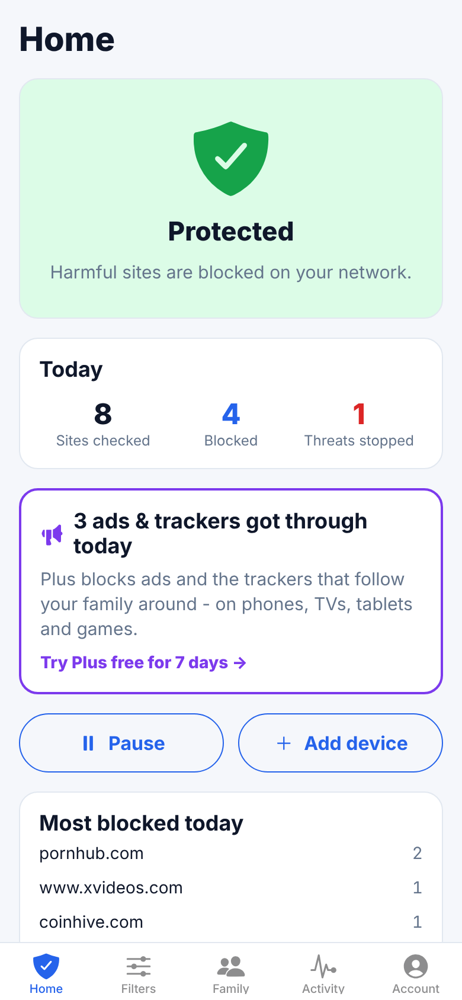
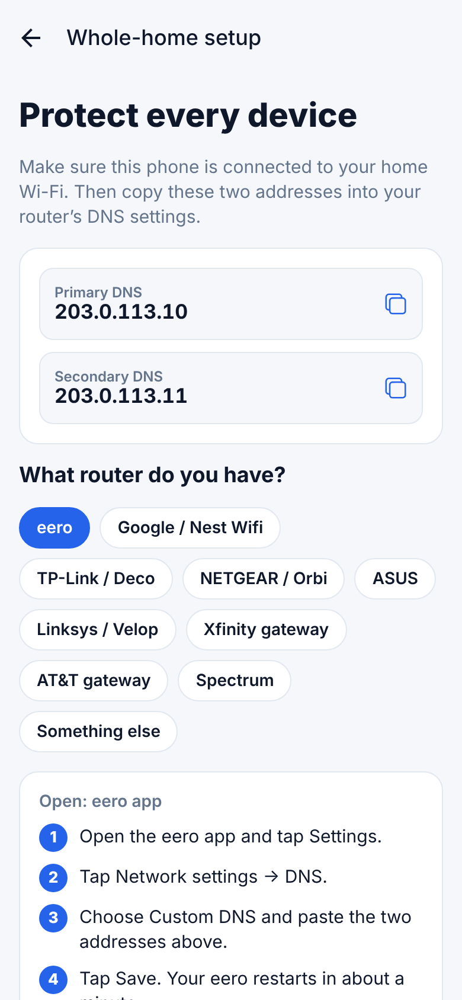
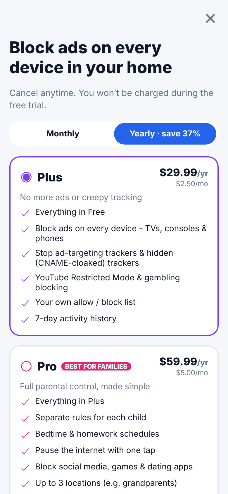
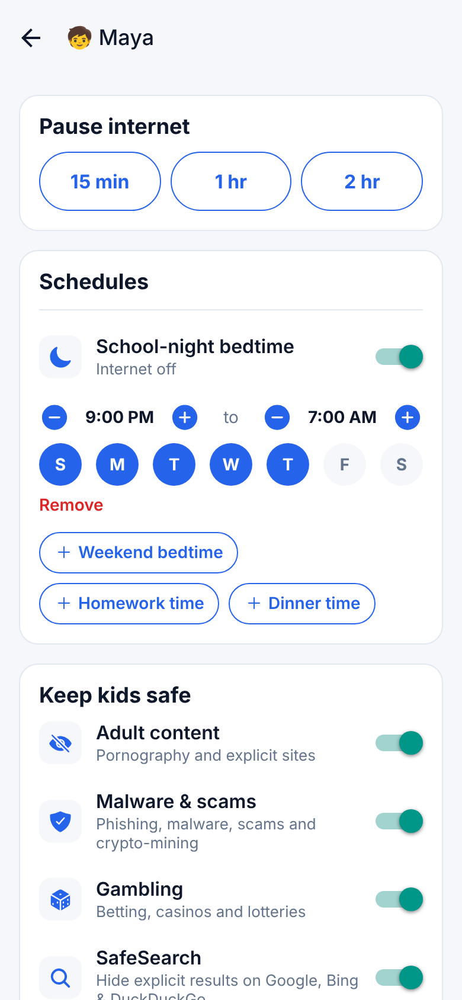

# KinShield: safe Wi-Fi for families

KinShield is a mobile app that replaces confusing router admin panels with a few switches. Parents change one router setting, or install a profile on one device. After that, adult sites, malware and (on paid plans) ads and trackers are blocked on every phone, tablet, TV and console in the home.

Filtering happens at the DNS level, so kids' devices need no software and every kind of device is covered.

<p>
  
  
  
  
</p>

```
mobile/   Expo (React Native) app: iOS + Android
server/   API + filtering DNS resolver (UDP/TCP 53, DNS-over-TLS 853, DNS-over-HTTPS)
shared/   Plans, features, policy logic. Single source of truth for app and server
```

## Plans

Plans are defined in [`shared/src/plans.ts`](shared/src/plans.ts). The server enforces them, so a lapsed subscriber's paid rules stop applying automatically. Their settings are kept, so re-subscribing restores everything.

| | **Free** | **Plus**: $3.99/mo · $29.99/yr | **Pro**: $7.99/mo · $59.99/yr |
|---|---|---|---|
| Block adult sites | ✓ | ✓ | ✓ |
| Block malware, phishing, scams | ✓ | ✓ | ✓ |
| SafeSearch (Google/Bing/DDG) | ✓ | ✓ | ✓ |
| **Ad blocking on every device (incl. TVs, consoles)** | | ✓ | ✓ |
| **Anti-tracking: ad-targeting trackers + CNAME-cloaked trackers** | | ✓ | ✓ |
| YouTube Restricted Mode, gambling | | ✓ | ✓ |
| Custom allow/block list | | 100 sites | 2,000 sites |
| Activity history | | 7 days | 30 days |
| Per-child profiles | | | up to 10 |
| Bedtime & homework schedules | | | ✓ |
| Pause internet (household or one child) | | | ✓ |
| Block social media / games / dating | | | ✓ |
| Locations (e.g. grandparents' house) | 1 | 1 | 3 |
| Free trial | | 7 days | 7 days |

To change prices or move a feature between tiers, edit that one file. The paywall, lock badges and server enforcement all update together.

### How the app makes money

- **The Free plan shows what it misses.** For Free users the resolver also checks every *allowed* query against the ad/tracker lists. The home screen then says *"1,284 ads & trackers got through today. Try Plus free for 7 days"*, using the family's own numbers.
- **Every locked switch is a sales prompt.** Paid toggles show a 🔒 PLUS / PRO badge and open a paywall with a matching headline (e.g. "Pause the internet with one tap"). The server returns `402 upgrade_required` with the plan to upsell, so new paid features get a paywall without extra app code.
- **Paying users see results right away.** After an upgrade, newly unlocked protections that are on by default (ads, trackers, gambling) switch on automatically for every network and child.
- **Yearly is the default choice** and the paywall shows the saving (37%). Pro is labeled "Best for families".
- **Win-back:** cancelling never deletes settings, so re-subscribing restores everything in one tap.

## How it works

```
Router / device ──DNS──▶ KinShield resolver ──▶ who is asking? (linked home IP, or DoH/DoT id)
                                │                 └─ load their policy, clamp to their plan
                                ├─ blocked category / custom list / schedule / pause ─▶ 0.0.0.0
                                ├─ SafeSearch / YouTube ─▶ CNAME to forcesafesearch.google.com etc.
                                └─ otherwise forward upstream (EDNS Client Subnet stripped)
                                     └─ Plus+: answer CNAMEs to a tracker? ─▶ blocked (uncloaking)
```

- **Whole home:** the app calls `POST /networks/:id/link` while the phone is on home Wi-Fi. That records the home's public IP, and queries from that IP get the family's rules. The parent copies two IPs into the router, with brand-specific steps for eero, Google/Nest, TP-Link, NETGEAR, ASUS, Linksys and others. Some ISP gateways lock DNS (Xfinity, AT&T, Spectrum). For those, the app steers parents to per-device setup instead.
- **Per device / per child:** each network and each child profile gets an unguessable `dnsId`, which is used three ways:
  - iPhone/iPad/Mac: one-tap `.mobileconfig` that turns on encrypted DNS (DoH)
  - Android: Private DNS hostname `<dnsId>.dns.example.com` (DoT; the child is identified from SNI)
  - Chrome/Edge/Windows: a DoH URL

  Per-device protection also works on mobile data and other Wi-Fi networks.
- **Not an open resolver:** queries from unknown IPs or ids get `REFUSED`, which prevents DNS-amplification abuse.
- **Privacy:** Free keeps only daily counters. Plus and Pro keep domain-level history, which is pruned automatically to the plan's retention period. Client-subnet data is never forwarded upstream.

## Run it locally

```bash
npm install
npm test                      # shared + server tests (filtering, paywall, billing, DoH end-to-end)
npm run server:dev            # API on :8080, DNS on :5353
npm run update-blocklists -w server   # optional: download full category lists (~165k domains)
npm run mobile                # Expo; press i / a, or scan the QR with Expo Go
```

Set `mobile/app.json → expo.extra.apiUrl` to an address your phone can reach (e.g. `http://192.168.1.20:8080`).

With no RevenueCat keys configured, the app runs in **demo billing** mode: "Start free trial" switches the plan instantly so you can try every tier. In production this route is disabled (`ALLOW_DEV_PLAN_SWITCH` defaults to off when `NODE_ENV=production`).

## Going to production

1. **Resolver hosting.** Run the Docker image on 2+ servers with static public IPs (anycast later), and put those IPs in `RESOLVER_IPV4`. Expose UDP+TCP 53, TCP 853, and HTTPS for the API/DoH (behind a TLS proxy with `TRUST_PROXY=true`). Copy `server/.env.example`.
2. **TLS:** get a wildcard certificate for `*.dns.<your-domain>`, for Android Private DNS.
3. **Blocklists:** run `npm run update-blocklists` every 6h and send `SIGHUP` to reload. **Check list licences before you sell the service.** StevenBlack (MIT) and URLhaus (CC0) are included by default. HaGeZi/OISD add coverage but have their own terms. Consider a commercial threat feed for the security category.
4. **Subscriptions (RevenueCat):** setup is documented in [`server/src/billing.ts`](server/src/billing.ts).
   - Create entitlements `plus` and `pro`.
   - Create products `kinshield_{plus,pro}_{monthly,yearly}` with a 7-day trial, in App Store Connect and Play Console.
   - Point the webhook at `/v1/billing/revenuecat`.
   - Put the public SDK keys in `app.json → extra.revenueCat`.
   - Finish the `TODO(prod)` in `/v1/billing/sync`, which should verify the purchase with RevenueCat's REST API before trusting the client.
5. **Apple profile signing:** sign the `.mobileconfig` with your developer certificate so iOS shows it as "Verified".
6. **Scale:** SQLite (built into Node 22) is fine for one box and a few thousand families. When you run more than one API instance, move `server/src/db.ts` to Postgres. All SQL is in that one file.
7. **Store compliance:**
   - In-app account deletion is already included (Account → Delete account).
   - Auto-renewal terms are on the paywall.
   - Replace the placeholder Terms, Privacy and Support links in `app.json`.
8. **Branding:** "KinShield" is a placeholder. Search for trademarks before launch, then change `app.json`, `BRAND_NAME` and the welcome screen.

## Project map

| Area | Files |
|---|---|
| Plans & entitlements | `shared/src/plans.ts`, `shared/src/policy.ts` (`clampPolicy`, schedules) |
| Filtering decisions | `server/src/dns/engine.ts` |
| Resolver, CNAME uncloaking, stats | `server/src/dns/resolver.ts`, `upstream.ts`, `listeners.ts` |
| REST API + paywall enforcement | `server/src/api.ts` |
| Billing webhook | `server/src/billing.ts` |
| App screens | `mobile/app/*` (Expo Router), `mobile/src/components/PolicyEditor.tsx` |
| Paywall & purchases | `mobile/app/paywall.tsx`, `mobile/src/billing.ts` |
| Router how-tos | `mobile/src/routerGuides.ts` |
